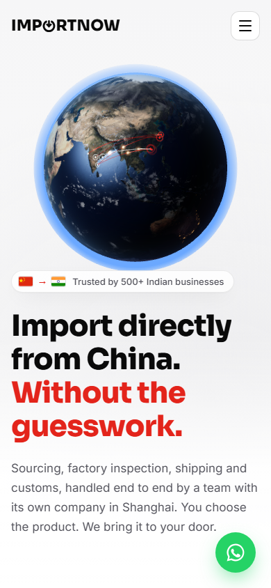

# ImportNow Website Recreation

**Live website:** [https://importnow-recreation.vercel.app](https://importnow-recreation.vercel.app)

**Reference website:** [https://importnow-concept.vercel.app/#home](https://importnow-concept.vercel.app/#home)

**Project author:** Thilagavathi S

## Overview

This project recreates the ImportNow China-to-India import-services website as a responsive React application. It presents the sourcing and shipping journey, product categories, Shanghai presence, business trips, illustrative project examples, import guides, FAQs, and a quote enquiry form.

The interface is built around a Three.js Earth visual and a scroll-controlled shipment scene. It is a frontend recreation for a project assignment, not an official ImportNow product or a source of verified service, customer, or shipment claims.

## Screenshots



*Mobile homepage capture from local Playwright visual QA.*

## Features

- Responsive page layout and mobile navigation.
- Animated Three.js globe with locally bundled Earth textures, route arcs, and moving indicators.
- Scroll-controlled shipment journey with a Three.js ship scene and a visual fallback.
- Services, product categories, Shanghai presence, business trips, guides, FAQ, and footer sections.
- Illustrative case-study examples; no verified client shipments are claimed.
- Testimonial placeholders that remain unpublished until approved customer quotes are available.
- Quote form validation and a WhatsApp-ready message preview. No backend or WhatsApp number is configured.
- Reduced-motion support and keyboard-accessible interactive controls.

## Technologies and tools

| Area | Tools |
| --- | --- |
| Application | React, JavaScript, CSS |
| Development server and build | Vite |
| 3D visuals | Three.js |
| Testing and linting | Playwright, Oxlint |
| Source control | Git, GitHub |
| Hosting | Vercel |
| Development environment and AI assistance | VS Code, GitHub Copilot (Copilot SDK assistance) |

## Project structure

```text
public/
  assets/                 Earth and water textures, with attribution
src/
  components/
    layout/               Shared header, footer, and floating contact control
    ui/                   Reusable buttons, icons, and section headings
    visuals/              Three.js Earth and shipment scenes
  config/                 Contact configuration
  data/                   Section content and journey stages
  features/quote-form/    Quote-message generation
  sections/               Page sections
  styles/                 Global styles and design tokens
  App.jsx                 Page composition and shared interactions
tests/
  website.spec.js         Functional and responsive end-to-end checks
  capture-sites.spec.js   Reference and local visual captures
docs/screenshots/         README screenshot
```

## Run locally

Use a current Node.js LTS release and npm.

```powershell
npm install
npm run dev
```

Vite prints the local development URL after startup.

## Test and build

```powershell
npm run lint
npm run build
npm run test:e2e
```

The Playwright configuration starts the Vite development server for the end-to-end suite. Tests cover desktop, tablet, and mobile layouts, navigation, page sections, the animated scenes, FAQ behavior, and quote-message generation.

To capture comparison screenshots:

```powershell
npm run qa:capture
```

Captures are written to `test-results/captures/`, which is intentionally excluded from Git. Capturing the reference site requires internet access.

## Credits and project notes

- The reference website is linked above for design comparison. This recreation is an independent assignment project and is not affiliated with the reference site.
- Earth and water texture maps are from the Three.js texture examples and are distributed under the Three.js MIT license. See [public/assets/ATTRIBUTION.txt](public/assets/ATTRIBUTION.txt).
- Case-study cards are explicitly illustrative examples. Testimonials are placeholders, not customer endorsements.
- The quote form prepares a message locally. WhatsApp sending remains disabled until a verified number is configured in `src/config/contact.js`.
- The project does not require paid APIs, a backend, or environment secrets.
